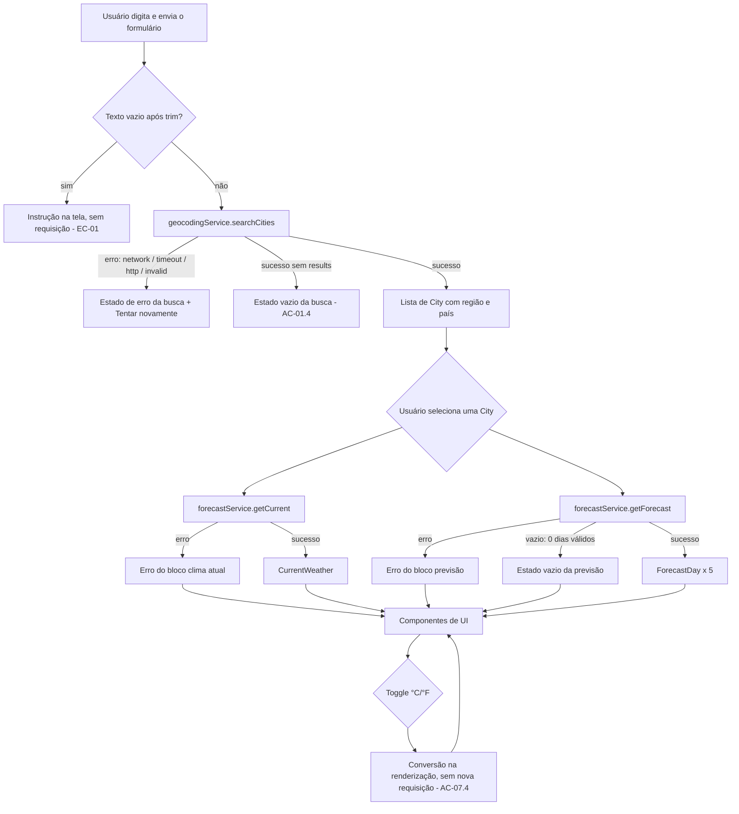

# Plano Técnico — Aplicativo de Previsão do Tempo

**Fonte da verdade:** [specs/weather-app-spec.md](../specs/weather-app-spec.md) (Rascunho v2).
**Status:** Rascunho para revisão. Decisões de Plano marcadas com **[decidido PM]** vieram da validação do PM; as demais são propostas técnicas.

> Este plano define decisões, contratos (tipos e interfaces) e estratégia. Não contém código final.

---

## Architecture Overview

SPA estática em camadas, sem backend próprio (AS-01):

```
components (apresentação)  →  hooks (orquestração e estado)  →  services (acesso a dados)
                                         ↓
                                  lib (funções puras)
```

- **components/**: renderizam dados e disparam eventos. Não chamam `fetch`.
- **hooks/**: orquestram busca, seleção e carregamento; expõem um estado explícito; descartam respostas obsoletas (EC-06, EC-07).
- **services/**: única camada que conhece a Open-Meteo; converte a resposta bruta para os tipos do domínio.
- **lib/**: funções puras (conversão de unidade, tradução WMO, formatação de data e hora). Testáveis sem DOM nem rede.

Por que essa separação: cada camada tem uma responsabilidade e pode ser testada isoladamente. Services são testados com `fetch` mockado, lib com entradas e saídas simples, e components com o estado injetado por props.

---

## Tech Stack

| Área | Escolha | Observação |
|------|---------|------------|
| Linguagem | TypeScript (`strict`) | Convenção do projeto |
| UI | React + Vite | SPA estática; build gera `dist/` |
| Estilo | Tailwind CSS | Tema dark glassmorphism; contraste validado (R-07) |
| Dados | Open-Meteo (geocoding + forecast) | Sem API key (D-01); licença pendente (OQ-17) |
| Testes unitários | Vitest + Testing Library | |
| Testes E2E | Playwright | Inclui viewport mobile de 320 px |
| Acessibilidade automatizada | `@axe-core/playwright` (nova devDependency) | Varredura WCAG 2.1 AA no E2E (RNF-02) |
| PWA | `vite-plugin-pwa` (nova dependência) | **[decidido PM]** PWA incluído na v1; ver seção Decisões |
| Pacotes | pnpm | |
| Lint e formato | Biome | |

Novas dependências exigem atualização de `package.json` e `pnpm-lock.yaml` na fase Code.

---

## Project Structure

```
src/
├── components/            # um componente por arquivo
│   ├── SearchForm.tsx         # campo de busca + botão "Buscar" (submit)
│   ├── CityResultList.tsx     # lista de resultados (teclado: setas, Enter, Esc)
│   ├── CurrentWeatherCard.tsx # clima atual
│   ├── ForecastSection.tsx    # previsão de 5 dias (hora a hora)
│   ├── UnitToggle.tsx         # °C / °F com aria-pressed
│   ├── StatusMessage.tsx      # loading, erro, vazio (aria-live)
│   └── App.tsx                # composição da tela
├── hooks/
│   ├── useCitySearch.ts       # estado da busca de cidades
│   ├── useWeather.ts          # clima atual e previsão da cidade selecionada
│   └── useTemperatureUnit.ts  # unidade ativa (estado de sessão)
├── services/
│   ├── openMeteoClient.ts     # fetch com timeout e classificação de erro
│   ├── geocodingService.ts    # busca de cidades
│   └── forecastService.ts     # clima atual + previsão horária
├── lib/                   # funções puras
│   ├── temperature.ts         # toDisplayTemperature, convertCelsiusToFahrenheit
│   ├── wmoCodes.ts            # código WMO → texto pt-BR
│   ├── forecastGrouping.ts    # 120 entradas horárias → 5 dias
│   └── formatters.ts          # formatação de data, hora e região
├── types/
│   └── weather.ts             # contratos do domínio
├── pwa/                   # registro do service worker (se necessário)
└── main.tsx

tests/
├── unit/                  # Vitest: lib, services (fetch mockado), hooks e componentes
└── e2e/                   # Playwright: fluxos principais e mobile 320 px
```

Convenções (instruções do projeto): componentes em `src/components/`, acesso a dados em `src/services/`, hooks em `src/hooks/`, tipos em `src/types/`.

---

## Data Model

Contratos em `src/types/weather.ts`. Campos em pt-BR quando são texto exibido; identificadores em en-US.

```ts
/** Unidade de exibição das temperaturas. Padrão: 'celsius' (AS-04). */
export type Unit = 'celsius' | 'fahrenheit';

/** Cidade retornada pelo geocoding. Homônimos se diferenciam por region e country (RF-01). */
export interface City {
  id: number;            // id do geocoding; chave estável para a lista
  name: string;          // nome da cidade
  region?: string;       // admin1: estado/região, quando disponível
  country: string;       // nome do país
  countryCode?: string;  // ISO 3166-1 alfa-2
  latitude: number;
  longitude: number;
  timezone: string;      // fuso IANA, ex.: 'America/Sao_Paulo' (AS-06)
}

/** Clima atual (RF-02). Campos ausentes da API ficam null e são exibidos como "não disponível" (AC-03.2). */
export interface CurrentWeather {
  observedAt: string;          // horário local da cidade, ISO sem offset, ex.: '2026-11-11T14:00'
  temperatureC: number | null; // temperatura em °C, sempre armazenada em Celsius
  condition: string;           // texto pt-BR derivado do código WMO
  relativeHumidity: number | null; // %
  windSpeedKmh: number | null;     // km/h (AS-07, não converte com o toggle)
  pressureHpa: number | null;      // hPa, pressão ao nível do mar (pressure_msl)
  precipitationMm: number | null;  // mm
}

/** Uma hora da previsão (RF-03). */
export interface HourlyForecast {
  time: string;                // horário local da cidade, ISO sem offset
  temperatureC: number | null; // °C
  condition: string;           // texto pt-BR
  precipitationMm: number | null;
  precipitationProbability: number | null; // % de probabilidade de chuva (precipitation_probability)
}

/** Um dia da previsão: 24 entradas horárias (AC-02.1). */
export interface ForecastDay {
  date: string;                // 'YYYY-MM-DD' no fuso da cidade
  hours: HourlyForecast[];     // 24 itens quando completo
}

/** Dados completos de uma cidade, montados pela camada de services. */
export interface WeatherData {
  city: City;
  current: CurrentWeather;
  forecast: ForecastDay[];     // 5 dias: hoje + 4 (D-02)
  fetchedAt: string;           // ISO UTC, para o rótulo "atualizado às HH:MM" (RNF-12)
}

/** Erro normalizado vindo da camada de services (RNF-10: sem jargão na UI). */
export type WeatherErrorKind = 'network' | 'timeout' | 'http' | 'invalid';

export interface WeatherError {
  kind: WeatherErrorKind;
  status?: number;             // apenas para logs; nunca exibido ao usuário
}
```

Observação sobre o modelo: o clima atual e a previsão têm erros independentes (EC-08). Por isso `WeatherData` pode ser montado a partir de dois resultados separados (ver Data Flow), e cada bloco tem seu próprio estado.

---

## External APIs

Base URLs (sem API key):

- Geocoding: `https://geocoding-api.open-meteo.com/v1/search`
- Forecast: `https://api.open-meteo.com/v1/forecast`

### Geocoding

| Parâmetro | Valor | Motivo |
|-----------|-------|--------|
| `name` | texto digitado, já `trim()` | Busca por nome |
| `count` | `10` | Limite de resultados (proposta; OQ-05 aberta) |
| `language` | `pt` | Nomes e regiões em português quando disponíveis |
| `format` | `json` | |

Exemplo resumido de resposta:

```json
{
  "results": [
    {
      "id": 3448439,
      "name": "São Paulo",
      "latitude": -23.5475,
      "longitude": -46.63611,
      "country": "Brasil",
      "country_code": "BR",
      "admin1": "São Paulo",
      "timezone": "America/Sao_Paulo"
    }
  ]
}
```

Quando não há resultados, a API retorna `{}` sem a chave `results`. Isso gera o estado vazio (AC-01.4), não erro.

Mapeamento para `City`: `id` → `id`; `name` → `name`; `admin1` → `region`; `country` → `country`; `country_code` → `countryCode`; `latitude`/`longitude`/`timezone` diretos.

### Forecast — clima atual

Parâmetros:

| Parâmetro | Valor |
|-----------|-------|
| `latitude`, `longitude` | da `City` selecionada |
| `current` | `temperature_2m,relative_humidity_2m,weather_code,wind_speed_10m,pressure_msl,precipitation` |
| `wind_speed_unit` | `kmh` |
| `timezone` | `auto` (horários no fuso da cidade; AS-06) |

Exemplo resumido:

```json
{
  "timezone": "America/Sao_Paulo",
  "current": {
    "time": "2026-11-11T14:00",
    "temperature_2m": 27.4,
    "relative_humidity_2m": 61,
    "weather_code": 2,
    "wind_speed_10m": 12.3,
    "pressure_msl": 1011.2,
    "precipitation": 0.0
  }
}
```

Mapeamento para `CurrentWeather`: `current.time` → `observedAt`; `temperature_2m` → `temperatureC`; `weather_code` → `condition` via `wmoCodes.ts`; `relative_humidity_2m` → `relativeHumidity`; `wind_speed_10m` → `windSpeedKmh`; `pressure_msl` → `pressureHpa`; `precipitation` → `precipitationMm`. Campo ausente ou não numérico → `null`.

### Forecast — previsão horária

Mesma URL, com parâmetros adicionais:

| Parâmetro | Valor |
|-----------|-------|
| `hourly` | `temperature_2m,weather_code,precipitation,precipitation_probability` |
| `forecast_days` | `5` |

Com `forecast_days=5` e `timezone=auto`, a API retorna 120 entradas começando à meia-noite do dia local atual (AC-02.1). Exemplo resumido:

```json
{
  "hourly": {
    "time": ["2026-11-11T00:00", "2026-11-11T01:00"],
    "temperature_2m": [22.1, 21.8],
    "weather_code": [0, 1],
    "precipitation": [0.0, 0.0],
    "precipitation_probability": [0, 10]
  }
}
```

Mapeamento: `hourly.time[i]`, `temperature_2m[i]`, `weather_code[i]`, `precipitation[i]`, `precipitation_probability[i]` viram um `HourlyForecast`. A probabilidade diária exibida no card é o maior valor entre as horas do dia. A função `forecastGrouping.ts` (pura) agrupa por `time.slice(0, 10)` em `ForecastDay`.

Validação: se `hourly.time` não tiver 120 entradas, o serviço ainda devolve os dias disponíveis. Dia com menos de 24 entradas é mantido com `hours` parcial. Se nenhum dia for válido, o serviço retorna `invalid` (EC-12).

### Por que dois requests

**[decidido PM]** Clima atual e previsão são obtidos em requisições independentes. Isso permite que cada bloco tenha erro e loading próprios (EC-08, AC-RF03.1), e que a previsão falhe sem derrubar o clima atual. O custo é uma requisição a mais por seleção de cidade, aceitável para o volume esperado.

---

## Data Flow

### Busca → seleção → clima e previsão



### Regras do fluxo

- **Busca só ao enviar** o formulário (Enter ou "Buscar") **[decidido PM]**. Sem debounce nesta versão.
- **Descarte de respostas obsoletas:** cada busca e cada seleção recebe um `requestId` crescente. A resposta só é aplicada se o `requestId` ainda for o atual (EC-06, EC-07, R-12). Alternativa: `AbortController` cancela a requisição anterior; o plano usa os dois mecanismos, com o `requestId` como garantia final.
- **Seleção de cidade** dispara as duas requisições em paralelo (`Promise.allSettled`), cada uma atualizando seu próprio bloco.
- **Troca de unidade** não altera o estado de dados. A conversão acontece na renderização (ver State Management).

---

## State Management

### Onde o estado vive

| Estado | Local | Motivo |
|--------|-------|--------|
| Texto digitado | `useCitySearch` (estado local do formulário) | Só existe na tela de busca |
| Resultados da busca | `useCitySearch` | Descartado quando uma cidade é escolhida |
| Cidade selecionada | `App` (via `useWeather`) | Fonte única para clima e previsão |
| Clima atual e previsão | `useWeather`, em dois estados independentes | Erros e loading separados (EC-08) |
| Unidade (°C/°F) | `useTemperatureUnit`, em memória | Sessão apenas (D-03, OQ-04 parcial) |

Sem biblioteca de estado global. Os dados são locais à árvore do `App`, o que basta para uma SPA desta escala.

### Estados explícitos

Cada bloco de dados usa uma união discriminada:

```ts
export type AsyncState<T> =
  | { status: 'idle' }
  | { status: 'loading' }
  | { status: 'success'; data: T }
  | { status: 'empty' }
  | { status: 'error'; error: WeatherError };
```

- Busca: `idle` (instrução, EC-01), `loading`, `success` (lista), `empty` (EC-04), `error`.
- Clima atual: `idle` (AC-RF07.1), `loading`, `success`, `error`. O `empty` não se aplica, pois um clima sem dados é tratado como `error` `invalid`.
- Previsão: `idle`, `loading`, `success` (≥1 dia), `empty` (0 dias válidos, AC-RF06.3), `error`.

### Conversão de unidade

- O serviço sempre entrega temperaturas em Celsius (`temperatureC`).
- A conversão ocorre na apresentação: `toDisplayTemperature(celsius, unit)` em `lib/temperature.ts`.
- Regra: `°F = °C × 9/5 + 32`, arredondado para inteiro (AS-10). Valores `null` viram `—` com nome acessível "não disponível".
- Como a conversão é pura e a fonte é Celsius, a troca não dispara requisição (AC-07.4) e não há risco de dupla conversão.
- Velocidade, pressão e precipitação não passam pela conversão (AS-07).

### Ordem de aplicação da unidade

Se a unidade muda durante o loading, os dados são renderizados na unidade atual quando chegam (EC-14). Se a previsão está em erro, nenhuma temperatura é exibida (EC-15); a preferência permanece.

---

## Error Handling

### Classificação (`openMeteoClient.ts`)

`openMeteoClient` encapsula `fetch` com:

- **Timeout de 3000 ms** **[decidido PM]**, via `AbortController` com `setTimeout`. O timer é limpo ao concluir.
- **Classificação do erro:**

| Situação | `WeatherError.kind` |
|----------|---------------------|
| Falha de rede (`TypeError` do `fetch`, offline) | `network` |
| Timeout (abort pelo timer) | `timeout` |
| HTTP 429, 5xx ou outro status não 2xx | `http` |
| JSON inválido ou campos obrigatórios ausentes | `invalid` |

- Nenhuma exceção não tratada chega à UI (AC-09.3). Os services retornam `Result`-like (`{ ok: true, data } | { ok: false, error }`) em vez de lançar.

### Mensagens ao usuário (pt-BR, sem jargão — RNF-10)

| `kind` | Mensagem |
|--------|----------|
| `network` | "Sem conexão com a internet. Verifique sua conexão e tente novamente." |
| `timeout` | "O serviço de clima demorou para responder. Tente novamente." |
| `http` | "Não foi possível obter os dados agora. Tente novamente em instantes." |
| `invalid` | "Recebemos dados incompletos do serviço. Tente novamente." |

Nenhuma mensagem exibe código HTTP, stack trace ou nome da API (RNF-10). O `status` fica apenas no `WeatherError` para diagnóstico.

### Regras

- Cada bloco tem o botão "Tentar novamente" que repete **somente** a sua requisição (AC-09.2).
- Retry automático: **não** (proposta; OQ-12 parcialmente resolvida pela decisão de timeout). Cache entre sessões: não (AS-11).
- Resposta parcial: campos ausentes viram `null` e aparecem como "não disponível" (AC-03.2). Resposta sem estrutura mínima vira `invalid`.
- Código WMO desconhecido → "Condição indisponível" (AC-03.3, EC-13).
- Erros de busca e de previsão não apagam o clima atual já exibido (EC-08).
- Mensagens de erro usam `role="alert"` ou região `aria-live="assertive"`, e o botão fica associado via `aria-describedby` (AC-06.1, AC-06.2).

---

## Testing Strategy

### Unitários (Vitest, `tests/unit/`)

| Alvo | O que cobrir | ACs / ECs |
|------|--------------|-----------|
| `lib/temperature.ts` | Conversão °C → °F; −40 → −40; 0 → 32; 100 → 212; arredondamento; `null` | AC-07.3, EC-16 |
| `lib/wmoCodes.ts` | Todos os códigos mapeados; código desconhecido → "Condição indisponível" | AC-03.3, EC-13, R-10 |
| `lib/forecastGrouping.ts` | 120 entradas → 5 dias × 24; dia parcial; agrupamento pela data local | AC-02.1, EC-12 |
| `services/openMeteoClient.ts` | Timeout, rede, 429, 5xx, JSON inválido (`fetch` mockado) | AC-09.1, AC-09.3, EC-09, EC-11 |
| `services/geocodingService.ts` | Mapeamento de `results`; `{}` → vazio; homônimos distintos | AC-01.2, AC-01.3, EC-05 |
| `services/forecastService.ts` | Clima atual e previsão separados; campos ausentes → `null` | AC-03.2, AC-RF03.1, EC-08 |
| `hooks/useCitySearch.ts` | Texto vazio não dispara; `requestId` descarta resposta antiga | AC-01.1, EC-06 |
| `hooks/useWeather.ts` | Troca de cidade descarta resposta antiga; blocos independentes | EC-07, EC-08 |
| Componentes | Estados loading, erro, vazio e sucesso; `aria-pressed` no toggle; foco e labels | AC-05.2, AC-06.1, AC-06.2, AC-RF06.1 a AC-RF06.3 |

Critério: cada AC deste plano tem pelo menos um teste (unit ou E2E). AC-04.1 permanece sem teste até OQ-06.

### E2E (Playwright, `tests/e2e/`)

- Fluxo principal: busca → seleção → clima atual + previsão → troca de unidade.
- Teclado: navegação entre campo, resultados e toggle sem mouse (AC-05.1, AC-05.3).
- Mobile 320 px: sem scroll horizontal (AC-08.1) e alvos com ≥ 44×44 px (AC-08.2). Projeto de viewport dedicado no `playwright.config.ts`.
- Falha simulada da API (rota interceptada com erro e com timeout): mensagem exibida e "Tentar novamente" funciona (AC-09.1, AC-09.2).
- Troca de unidade sem nova requisição: contar chamadas de rede (AC-07.4).
- Acessibilidade: varredura `@axe-core/playwright` sem violações críticas (RNF-02).
- PWA: manifest presente e service worker registrado (decisão PWA).

Testes E2E rodam contra o build de produção (`pnpm build` + preview), não contra o dev server.

### Comandos de validação

Checklist do projeto (apenas para fases Code e Test):

```bash
pnpm lint
pnpm build
pnpm test
```

Comando E2E: `pnpm exec playwright test`.

---

## Decisões de Plano

| # | Tema | Decisão | Origem |
|---|------|---------|--------|
| D-P1 | Timeout | 3000 ms por requisição | **[decidido PM]** (substitui a proposta de 8 s) |
| D-P2 | Requisições | Clima atual e previsão em requests separados | **[decidido PM]** |
| D-P3 | Busca | Disparada só ao enviar o formulário; sem debounce | **[decidido PM]** (resolve parte de OQ-05) |
| D-P4 | PWA | PWA incluído na v1 (manifest + service worker) | **[decidido PM]** (resolve OQ-21 como PWA) |
| D-P5 | Retry | Manual apenas, pelo botão "Tentar novamente" | Proposta técnica (OQ-12) |
| D-P6 | Cache | Sem cache entre sessões | Proposta técnica (AS-11) |
| D-P7 | Conversão | Feita na apresentação, a partir de Celsius | Proposta técnica (R-04) |
| D-P8 | Pressão | `pressure_msl`, em hPa | Proposta técnica |
| D-P9 | Fuso | `timezone=auto` (horário da cidade) | Proposta técnica (AS-06, OQ-13) |
| D-P10 | Vento | Não acompanha o toggle; sempre km/h | AS-07 (OQ-13 aberta) |
| D-P11 | Limite de resultados | 10 | Proposta técnica (OQ-05 aberta) |
| D-P12 | Acessibilidade | WCAG 2.1 AA | Decisão do PM (RNF-02) |

---

## Risks & Trade-offs

### Riscos e mitigações

| Risco | Impacto | Mitigação |
|-------|---------|-----------|
| Open-Meteo sem SLA ou com cota (R-01, R-09, OQ-17) | Alto | Acesso isolado em `openMeteoClient`; erros tratados; licença e atribuição verificadas antes do deploy. **OQ-17 bloqueia produção.** |
| Timeout de 3 s pode ser curto em 4G lento (R-06) | Médio | Mensagem de timeout com retry manual; medir em E2E com throttling (RNF-03). Ajustar após medição. |
| PWA com comportamento offline indefinido (OQ-19) | Médio | Shell estático em cache; dados de clima **não** são cacheados e exibem erro de conexão. Confirmar com o PM antes da fase Code. |
| Homônimos na busca (R-03) | Médio | Região e país sempre exibidos. |
| Respostas fora de ordem (R-12) | Médio | `requestId` e `AbortController`. |
| Tradução WMO inconsistente (R-10) | Baixo | Tabela única em `wmoCodes.ts`, coberta por teste. |
| Contraste no glassmorphism (R-07) | Médio | Checagem com axe no E2E antes do Review. |
| Base path do GitHub Pages (OQ-10) | Médio | `base` do Vite configurável por variável de ambiente; default `/`. |
| Escopo crescer (R-08) | Alto | Out of Scope do spec; PWA não abre outras funcionalidades. |

### Trade-offs

- **Dois requests vs. um:** mais chamadas à API, em troca de erros e loading independentes (EC-08).
- **Conversão na apresentação vs. no service:** a conversão é trivial e pura; manter a fonte em Celsius evita dupla conversão e permite a troca sem request (AC-07.4).
- **Sem estado global:** menos código e menos superfície de teste, suficiente para uma tela. Alternativa considerada: Zustand. Descartada por não haver estado compartilhado fora da árvore do `App`.
- **Sem cache:** dados sempre atuais (RNF-12), ao custo de mais requisições. Alternativa: cache em `localStorage` com TTL; descartada até OQ-12 e OQ-18 serem respondidas.
- **Retry manual:** evita tempestade de requisições em falha de cota (EC-20). Alternativa: retry com backoff; reavaliar se o PM quiser.
- **Busca no submit:** menos requisições e mais previsível para teclado e leitor de tela. Alternativa: debounce; descartada por decisão do PM.
- **PWA na v1:** atende "mobile" como app instalável, mas adiciona service worker, manifest e testes extras. Alternativa: web responsiva apenas (menos escopo).

### Inconsistências encontradas no repositório (corrigir na fase Tasks)

- `pnpm lint` inclui `tests/`, mas `pnpm build` (`tsc -b`) pode não cobrir essa pasta. Verificar `tsconfig` antes de confiar no build como validação de tipos dos testes.

---

## Open Questions que permanecem após o plano

| ID | Pergunta | Quando resolver |
|----|----------|-----------------|
| OQ-05 | Caracteres mínimos e tamanho máximo do campo | Antes da fase Code |
| OQ-06 | Cidade padrão e favoritos | Fora desta versão até decisão |
| OQ-08 | Matriz de navegadores e larguras | Antes do E2E |
| OQ-10 | Base path final do GitHub Pages | Antes do deploy |
| OQ-13 | Vento acompanha o toggle? (proposta: não) | Antes da fase Code |
| OQ-17 | Licença comercial e limites do Open-Meteo | **Antes de produção** |
| OQ-18 | Exibição de "atualizado às HH:MM" | Antes da fase Code |
| OQ-19 | Comportamento offline do PWA | Antes da fase Code |
| OQ-20 | Textos pt-BR dos códigos WMO | Antes da fase Code |
| OQ-22 | Analytics e consentimento (LGPD) | Antes do Release |

---

## Rastreabilidade

| Requisito | Seção do plano |
|-----------|----------------|
| RF-01 (busca) | External APIs (Geocoding), Data Flow, `useCitySearch` |
| RF-02 (clima atual) | External APIs (Forecast atual), Data Model `CurrentWeather` |
| RF-03 (previsão 5 dias) | External APIs (Forecast horário), `forecastGrouping.ts` |
| RF-04 (°C/°F) | State Management, `lib/temperature.ts` |
| RF-05 (mobile) | Testing Strategy (E2E 320 px), Tailwind |
| RF-06 (loading, erro, vazio) | State Management (`AsyncState`), Error Handling |
| RF-07 (estado inicial) | State Management (`idle`) |
| RNF-01 a RNF-12 | Ver seções correspondentes e Risks |
| EC-06, EC-07 | Data Flow (`requestId`), Testing (`useCitySearch`, `useWeather`) |
| EC-08 | Decisão D-P2, Error Handling |
| EC-09 | Error Handling (timeout 3 s) |
| EC-12, EC-13 | Error Handling, `forecastGrouping.ts`, `wmoCodes.ts` |
| EC-16 | `lib/temperature.ts`, Testing Strategy |
